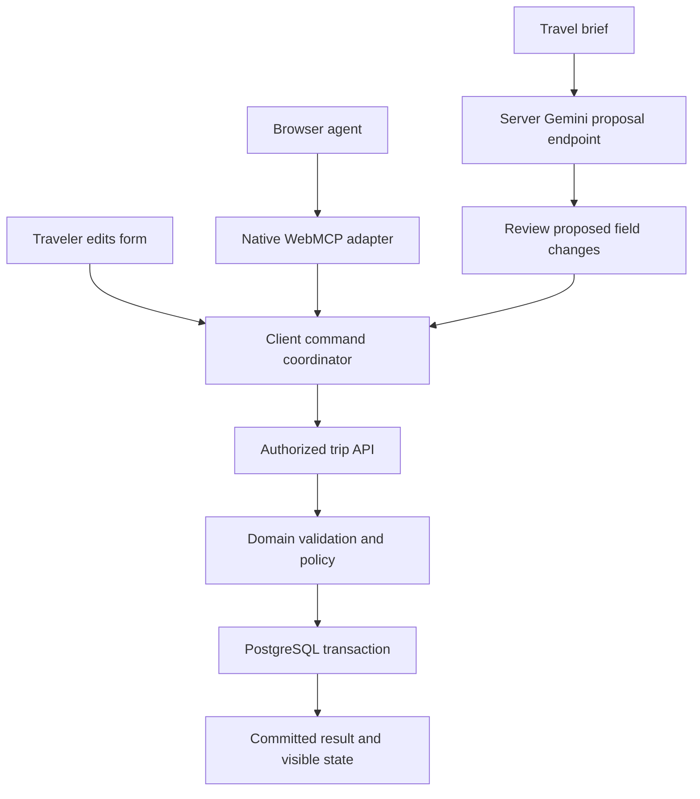

# Trip Workbench build specification

Plan revision 2, October 14, 2026. Read [CONTRACTS_AND_EXAMPLES.md](CONTRACTS_AND_EXAMPLES.md) for the concrete application contracts and examples, and [CURSOR_PROMPTS.md](CURSOR_PROMPTS.md) for the expanded six core stages plus optional stage. Those concrete contracts refine the high-level design here; version-sensitive SDK/browser methods must also match the installed versions.

## Decision and purpose

Build a separate application named **Trip Workbench**, repository **trip-workbench**. Its user task is preparing and submitting a business trip request. Its educational purpose is showing how a working web application can accept AI assistance without losing authorization, validation, visible state, or verifiable outcomes.

This fits Raju's experience with React and TypeScript, proactive travel assistance, Gemini, application testing, and AgentInspect. The reference implementation can be shared publicly without copying company code or representing synthetic travel inventory as an external service.

Develop a single coherent workflow deeply. WebMCP and Gemini are the two primary integrations. Chrome's Summarizer API is an optional later addition with a specific job: condensing a long travel brief for the traveler to review.

## User journey and interface

The signed-in traveler can:

1. Create or reopen a trip draft.
2. Enter a brief or edit fields manually.
3. Ask Gemini to propose structured fields, review the proposed changes, and apply them.
4. Let a browser agent use the registered draft tools.
5. See missing fields, invalid combinations, and deterministic policy findings.
6. Review the exact saved draft and submit a request.
7. Reload the page and retrieve the same request and persisted details.

Use a compact business application layout: request list, editor, and a contextual assistance panel. In the editor, show route, dates, traveler count, cabin, purpose, saved/unsaved status, and policy findings. The assistance panel shows proposed field differences, clarification questions, request progress, cancellation, and recovery. Put version diagnostics and raw traces on a separate development-only diagnostics route.

Use visible capability labels that help users decide: “Gemini assistance,” “On-device summary,” and an unavailable explanation when needed. Do not fill the everyday product screen with SDK names, token logs, or testing machinery.

Manual entry must work without AI credentials and in browsers without WebMCP.

## What is real

| Component | Release behavior | Evidence required |
|---|---|---|
| React UI, API, PostgreSQL | Actual application behavior and persistence | API/DB tests and refreshed browser state |
| Session authentication | Actual local credential/session implementation with seeded demo accounts | Unauthorized, expired-session, and access-control tests |
| Gemini integration | Actual server-side request through the official SDK when live mode is configured | Provider response metadata and validated proposal |
| WebMCP | Actual browser API registration and invocation in a supported environment | Native discovery and invocation evidence |
| Chrome summary | Actual on-device API on a supported machine, if implemented | Availability, download/init, completion/cancel observations |
| Travel data | Small static airport list and synthetic organizational policies | Explicit fixture labeling |
| Airline/payment fulfillment | Not implemented | Product wording says “trip request,” never “ticket booked” |
| External identity provider | Not part of initial local demo auth | Document as an extension, not a shipped SSO feature |

Simulation remains useful for repeatable CI and failures. Label provider doubles and recorded runs explicitly. Never let a live provider failure silently become a passing fixture result.

## Reference reuse

Start with a new history/repository. Reuse selected patterns after reviewing the local versions.

- From `flight-search-demo`: accessible fields, controlled-input layout, selected component examples, and existing human interaction patterns.
- From `cypress-test-trust-demo`: client/server split, Express API, PostgreSQL setup, session handling, injected clock, resource access checks, idempotency concepts, and browser-to-API persistence assertions.
- Reimplement the trip request domain and new contracts. Do not copy the booking workflow, intentional defects, `cy.prompt` demonstration modes, or conference-specific scripts.
- Fix local form-state and date-handling shortcuts while adapting. The reference form includes permissive types and UTC/date conversions; it is not a complete draft-domain model.
- Record every reused/adapted source file and source commit in `docs/REFERENCE_REUSE.md`. Preserve applicable notices. Review third-party licenses before distributing copied material.

The inspected remote reference commits are recorded in SOURCE_REVIEW.md. Cursor must compare them with the actual local worktrees.

## Stack and boundaries

Use the reference application's lean stack:

- React + TypeScript + Vite.
- Express + TypeScript on Node, choosing a supported runtime compatible with the installed dependencies and recording the exact version.
- PostgreSQL through `pg`, migrations and deterministic seed scripts; Docker Compose for the local database.
- Zod for runtime shape validation; explicit domain functions for cross-field and contextual rules.
- Vitest for domain, API, and adapter tests; Cypress for ordinary user journeys.
- Official `@google/genai` SDK in server-only code.
- A small typed native WebMCP adapter in the browser.
- Google's experimental `webmcp-evals` tooling for model/browser evaluation, with the pinned setup described below.
- AgentInspect manual instrumentation or a documented supported integration, kept out of the critical business path.

Do not add NestJS, LangGraph, ADK, Genkit, Firebase AI Logic, a vector database, or an agent framework to the initial release. These can be considered later when a workflow requires their responsibilities. Reusing a working Express foundation helps isolate the actual questions about browser tools and AI behavior.

The embedded Gemini proposal flow calls the application API. It is not itself a WebMCP integration. A browser agent discovers and invokes native WebMCP tools. Both routes ultimately use the same trip commands and domain rules. Keep their evidence separate.

## Domain and state model

Start with one-way and round-trip requests. Defer multi-city, seat selection, loyalty accounts, live inventory, and ticketing.

Draft fields:

- `origin` and `destination`: known airport codes from the bounded reference list.
- `departureDate`, `returnDate`: calendar dates as `YYYY-MM-DD`, nullable while drafting.
- `tripType`: `one_way` or `round_trip`.
- `passengerCount`: integer 1–9; the signed-in traveler owns the request.
- `cabin`: `economy`, `premium_economy`, or `business`.
- `purpose`: bounded plain text.

Server-owned metadata: `id`, `tenantId`, `ownerId`, `revision`, `status`, timestamps, and policy version. Do not accept identity, ownership, status, approval, or policy-result fields from a model or update payload.

Persist incomplete drafts. Patch validation rejects malformed supplied values and unknown keys, then checks the merged candidate: reject invalid relationships when both related values are present, such as equal airports or a return before departure. Missing values remain valid draft state. Full validation reports missing required fields and blocks submission when incomplete. Policy review requirements do not make a draft structurally invalid.

Check actual calendar validity without relying on parsing a date-only string into the user's local midnight. Use an injected clock plus explicit application timezone. Resolve relative language against the supplied reference date and timezone; ambiguous language should produce a question. Do not infer a specific airport from an ambiguous city.

Example synthetic policies:

- Premium economy and business require review.
- Departure fewer than seven calendar days away requires review.
- Origin and destination must differ.
- Round trips require a return date on or after departure.

Distinguish validation errors from review requirements. A valid request that needs review may be submitted with that finding. The model cannot waive it.

Initial state transitions: `draft -> submitted`. Persist a submission snapshot and its review requirements. Manager approval, rejection, and amendment workflows are later extensions.

## Application commands and API

Build a transport-independent domain service. The UI and WebMCP adapter call the same client coordinator; the coordinator calls authorized API endpoints. Server rules remain authoritative even if browser code is bypassed.

Suggested endpoints, to be implemented and documented:

| Endpoint | Responsibility |
|---|---|
| POST /api/session | Authenticate a seeded demo user |
| DELETE /api/session | End the session |
| GET /api/session | Read minimum current identity/capabilities |
| GET /api/reference-data | Read bounded airports, cabins, timezone and safe policy summary |
| POST /api/trips | Create an owned draft |
| GET /api/trips and GET /api/trips/:id | List/read authorized resources |
| PATCH /api/trips/:id | Apply an allowlisted patch with expected revision and command ID |
| POST /api/trips/:id/validate | Evaluate the saved draft and policy version |
| POST /api/trips/:id/submit | Submit the reviewed revision idempotently |
| POST /api/trips/:id/proposal | Obtain a Gemini proposal without mutating the draft |
| GET /api/trips/:id/commands/:commandId | Read an authorized committed receipt for reconciliation |

Read actor and tenant from the verified session. Resolve resource access on every request; do not trust an ID merely because it came from your own UI. Use HTTP-only session cookies, expiration, same-origin requests, and explicit CSRF protection/Origin checks for mutations. Development HTTP exceptions must be confined to localhost. Seed two same-tenant travelers, an observer who can read that tenant’s trips but cannot mutate, and a traveler in a second tenant. The exact access matrix is in CONTRACTS_AND_EXAMPLES.md.

For an update, require `expectedRevision`, `commandId`, and `patch`. Use an atomic conditional update in a transaction, with actor, tenant, ownership, status, and revision enforced together. A read followed by an unconditional update does not protect against races.

Track idempotency by authenticated actor, tenant, resource scope, and command ID. Bind action and input to a stable canonical hash; creation uses a fixed create-trip scope. See the exact receipt contract in CONTRACTS_AND_EXAMPLES.md. An identical retry returns its original result; reusing a command ID with different input conflicts. Enforce uniqueness in the database. Use a distinct new command ID for submission; reusing an update command ID for submission conflicts because the action is part of the canonical input hash.

A replay receipt may refer to an earlier revision than the currently stored draft. Never overwrite the UI with that older snapshot; reconcile with the latest authorized read. Different simultaneous commands from one revision cannot both win.

Return explicit outcomes: applied, no change, rejected, conflict, or unknown pending reconciliation. A no-op does not invent a state change. Validation results are attached to the revision and policy version they checked.

## Three initial WebMCP tools

| Tool | Input | Outcome |
|---|---|---|
| get_trip_draft | draftId | Minimum authorized saved fields, revision, draft status, and indication of local unsaved edits |
| update_trip_draft | draftId, expectedRevision, commandId, patch | Applied values/revision or a structured rejection/conflict |
| validate_trip_draft | draftId, expectedRevision | Field issues and deterministic policy findings for that revision |

Use concise descriptions explaining partial drafts, required revision, writable fields, and unsupported actions. Tool schemas describe the input shape; the server still validates values and permissions. Validation is read-only. Draft update is a write even when it is reversible.

Return a bounded JSON-serializable domain result, encoded through the pinned WebMCP API's supported return format. Do not hard-code an assumed MCP content envelope or invent unsupported tool-return streams. Surface an error code, safe explanation, retry guidance, and field errors where relevant. Never return session tokens or unnecessary identity data.

Suggested codes: `UNAUTHENTICATED`, `FORBIDDEN`, `NOT_FOUND`, `INVALID_INPUT`, `REVISION_CONFLICT`, `USER_EDIT_IN_PROGRESS`, `IDEMPOTENCY_CONFLICT`, `NOT_EDITABLE`, `CANCELLED`, and `OUTCOME_UNKNOWN`.

Current official Chrome guidance on October 14 uses `document.modelContext`, `inputSchema`, asynchronous registration, and registration cleanup using an AbortSignal. It describes tool execution cancellation separately. Verify against the pinned browser/types and keep the adapter narrow. Do not assume a returned `.unregister()` handle. Unsupported browsers retain the normal application; an internal dispatcher or test double is never labeled native WebMCP.

Register three tools only in an editable owned draft editor; an observer gets read/validate only. Other routes and submitted drafts expose none. Require the requested draft ID to match the active draft. Register tools only when relevant authenticated UI is mounted. Manage pending registration and cleanup under React StrictMode. Read current state through the command service rather than closures holding stale drafts. Route change, logout, and account switch remove discoverable tools and guard ongoing work. Unregistering discovery and cancelling an execution are separate operations.

Keep tools same-origin. Add appropriate annotation hints, but never use hints as authorization or as proof of a human's consent. Chrome 156-only features are not a baseline requirement.

Submission is an explicit reviewed UI action in v1 and is not an agent tool. This limits exposed capabilities; it is not a claim that an ordinary webpage can reliably distinguish a human click from all browser automation. A production approval workflow would require enforceable server policy and appropriate confirmation mechanisms.

## Concurrent human edits and cancellation

Maintain separate saved server state and a local editable buffer. A database revision protects saved changes; it does not protect unsaved keystrokes.

- Refuse an agent update when the local form already has unsaved edits, returning `USER_EDIT_IN_PROGRESS`.
- Bind each Gemini proposal to the saved revision, local edit-generation token, brief version, and actor/route generation captured before the model request.
- If the user edits while Gemini is working, show the result as stale; do not silently apply it.
- If a native tool write is already in flight when the user types, retain the newer local buffer when its response arrives. Report that saved state changed but newer local edits remain. Present overlap for explicit resolution.
- Do not merge an overlapping patch automatically. A fresh server read may support a user-reviewed retry.
- Use deterministic request barriers in tests to reproduce these races.

Propagate cancellation through browser requests and provider calls where supported. Check cancellation before new work. A transport abort after dispatch does not prove the server transaction was undone. Reconcile with the command ID and authorized read before claiming “nothing changed” or retrying a mutation. Return confirmed committed state if that is what the server reports.

## Direct Gemini integration

Implement a single server-only provider adapter. Use `GEMINI_API_KEY` and `GEMINI_MODEL`; never a `VITE_` key or client storage. Current official examples use `@google/genai` with the Interactions API, and the catalog lists `gemini-3.8-flash`. Treat that as a candidate configuration until a live smoke test confirms access. Pin the SDK and record the selected API surface, model ID, and output-shape mapping. Do not mix Interactions and generateContent response formats.

Send only the minimum allowed draft fields, bounded brief text, reference date/timezone, and supported values. Structured output should contain allowlisted proposed field values, missing/ambiguous fields, and concise clarification questions. Bind revision and actor metadata in application code, not in generated content.

The model request never changes the draft. Parse the result, run Zod, then domain checks. A schema-shaped object can still contain impossible dates or an invalid route. Show a proposed diff and apply through the same update command after review. Do not use a generated confidence number to bypass validation.

Treat brief text and retrieved content as untrusted data. No arbitrary URL fetch, shell execution, dynamic tool creation, or database credentials are available to this model call.

Handle deadline, cancellation, rate limit, provider error, empty result, and invalid output. Bound provider retries; do not stack SDK retries and application retries without an attempt budget. A conservative starting budget is two total attempts for transient provider errors within one deadline, with actual behavior recorded and configurable. Validation failures remain visible instead of being silently rewritten indefinitely.

Modes:
- `disabled`: ordinary application works and Gemini is unavailable.
- `fixture`: explicit test/development double with clearly labeled responses.
- `live`: actual configured Gemini call. Missing configuration or failed provider access fails honestly.

Use progress states for structured extraction. Do not update canonical fields from partial JSON. If streaming is introduced later for explanatory text, define delta-versus-snapshot semantics and emit a single validated final proposal; do not concatenate partial local output and cloud fallback output.

## Native browser model evaluation

First prove native tool discovery and direct invocation without a model. Then test Gemini choosing and using those tools.

The reviewed `webmcp-evals` runner supports a Vercel AI SDK backend for browser execution with a Google provider model. In that source snapshot, its direct `gemini` browser method throws “Method not implemented.” Vercel here names an SDK backend; it does not require deploying the application to Vercel.

Do a bounded setup spike before making the runner central. Pin its commit/package, Chrome/channel, and dependency versions. Verify actual commands and flags with installed help/source.

Authentication is an explicit integration task: the inspected browser evaluator launches a browser and navigates a new page to the URL. It does not expose a login fixture in that path. Do not point it at a protected page and assume it inherits the developer's session.

Preferred solution: a small local wrapper around the pinned browser/registry/backend interfaces that creates an isolated browser context, logs in through the normal application flow, prepares one owned draft, executes the evaluation, and independently reads final DOM and authorized persisted state. Verify exports before using them. If a narrow source patch is needed, keep it in the tooling integration with attribution and an upgrade test. Never add an unauthenticated “evaluation login” endpoint to the product.

If the runner cannot be made to work in the supported environment within the setup budget, use Google's documented inspector/example agent for actual native model interaction and record the outcome manually. Preserve the automated gap; a custom in-app dispatcher is not a substitute claim for native browser evaluation.

## Optional on-device summary

After core evidence exists, add “Summarize brief on this device” using the Chrome Summarizer API. Its output is a review aid, not the source for policy or canonical fields.

Feature-detect `Summarizer`, check availability with matching options, and handle unavailable, downloadable, downloading, and available states. Initiate session creation/download through user activation; surface progress. Destroy sessions and handle creation that finishes after unmount by destroying the late result.

Use the current documented option values and typings. Do not paste legacy `window.ai.summarizer` code. Never claim a disk-space requirement is the downloaded model size.

An optional separately labeled cloud-summary action can be added if local capability is unavailable; omitting it in v1 is acceptable. If implemented, it requires an explicit user choice because it sends text off-device and uses a bounded summary-only endpoint. Do not automatically forward local-only input after an error. Separate attempts and cancel/restart rendering; a mixed partial stream must never be displayed as one answer.

## Observability

Record request ID, run ID, command ID, provider attempt, tool name, revision before/after, duration, result code, and independently observed outcome where available. Keep tokens/cost as unknown when the provider does not report enough data.

Browser/client telemetry is untrusted diagnostic data. Authorization and audit decisions come from the server. Capture synthetic values by default; avoid retaining raw prompts and personal data.

Use AgentInspect on the server/evaluation side after checking its installed public API. Start with manual instrumentation and an example trace. Do not invent a WebMCP adapter or import Node filesystem code into the browser. AgentInspect explains trajectories and recorded observations; it does not independently prove persistence or consent.

## Implementation milestones

| Milestone | Build | Exit evidence |
|---|---|---|
| M0 | Inspect references, verify API/browser/runner setup, choose versions, document reuse | Environment report and bounded implementation plan |
| M1 | Manual trip workflow, sessions, PostgreSQL, domain rules, revisions, submission | Working request survives refresh; meaningful unit/API/E2E passes |
| M2 | Three native WebMCP tools and lifecycle/concurrency behavior | Native discovery/direct-call report plus unsupported-browser behavior |
| M3 | Actual Gemini proposal endpoint and review UI | At least one live provider run and explicit negative-case results |
| M4 | Gemini-driven native tool evaluations and evidence | Per-run tool trajectory, independent state assertions, versions and limitations |
| M5 | Optional on-device summary | Actual-device results or clearly blocked status; explicit cloud choice |

M1–M4 constitute the first useful reference release. Work stage by stage; effort depends on reuse and actual browser/provider setup. Preserve a smaller working release if setup takes longer. Do not add M5 until the core story can be demonstrated.

## Definition of done and extension path

The main branch has a reproducible setup, deterministic CI, documented native-browser requirements, real integration modes, and results that distinguish pass, fail, blocked, and not run. No hard-coded assertion counts are targets.

Later extensions should answer a measured user need: manager review, synthetic flight option comparison, an optional grounded destination-information card with source attribution, or explicit translation. Grounded web information must not become authoritative airfare, policy, availability, or approval data.

A reusable React package can follow only after the same adapter survives more than one application and meaningful lifecycle tests. The initial contribution is the complete, understandable reference application.

